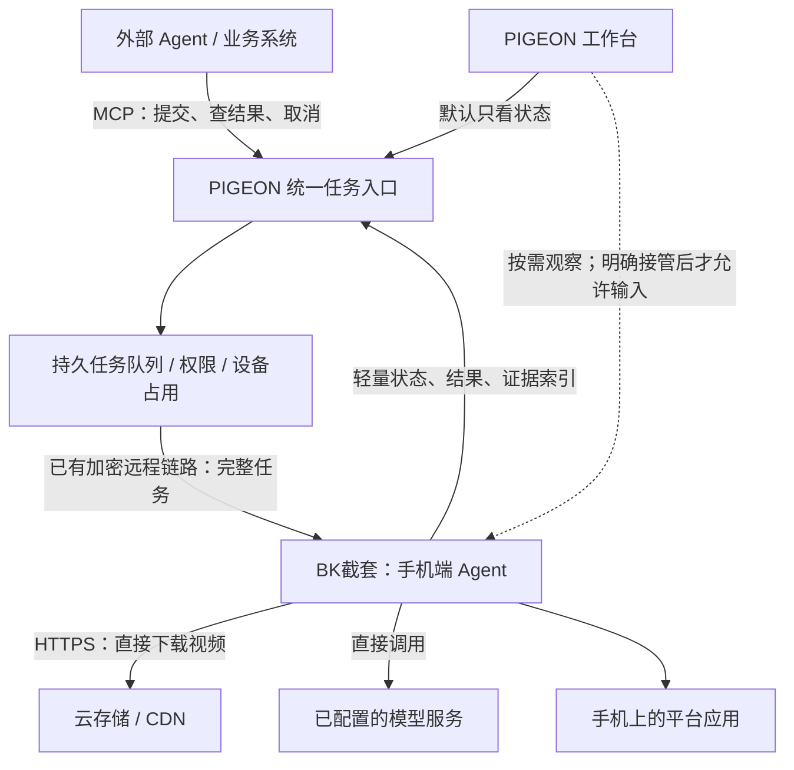

# PIGEON + BK截套：MCP 分布式手机任务二开实施方案

> 公开版本：真实任务、运行和证据标识已替换为匿名代号；原始验收记录保存在维护者的私有归档中。历史计划与实际验收状态以最新里程碑说明为准。

版本：方案 v1.1，Review 2 代码复核修订｜日期：2026-11-11｜状态：分阶段实施中，本文不是部署或容量验收报告。

实施进展另见 [单机真实发布验收](BK-MCP-PUBLISH-PILOT-20261111.md)：已完成小视频下载修复、统一 MCP 最小入口、一次抖音私密发布及截图复核；D1 自定义事件、观察页面、结构化发布契约和 16 台容量仍未完成。下文目标功能不能视为全部已交付。

用户认可的结果截图回传与聊天五分钟复查归档，已经过 [两轮留证方案代码复核](BK-EVIDENCE-TWO-PASS-REVIEW-20261111.md)。关键证据需可靠落盘、独立上传确认；提交前、结果未知、重要信息与交接节点也需覆盖。该增补仍为待实现契约，不能把已有调试截图或单机人工提取视为自动归档已完成。

本版按两个本地仓库的实际调用链修订。详细证据和撤回决策见 [Review 2 审查记录](BK-MCP-FLEET-REVIEW2-20261111.md)。必须保留的方向是手机执行、统一 MCP、云存储直下载和按需监控；新增 WebSocket、重建手机账本、固定服务器规格以及提前引入多节点，均不再作为既定实施决策。

目标：先验证一个地点的 16 台 Android 手机，再逐步扩到 20 个地点、共 320 台。外部 Agent 通过统一 MCP 提交业务任务，BK截套在手机端独立运行任务，PIGEON 负责设备管理、任务调度、监控和人工接管。视频由云存储直接下载到手机。

## 1. 已确定的架构与范围

### 1.1 三个职责，两个代码仓库

| 部分 | 放在哪里 | 负责什么 | 不承担什么 |
| --- | --- | --- | --- |
| 统一 MCP 与任务管理 | PIGEON 仓库中的独立模块；初期同机部署 | 身份权限、选设备、排队、下发、收据、状态汇总、限额和审计 | 不逐步指挥手机点击，不重复运行一套业务规划模型 |
| 监控与人工接管 | PIGEON 原有设备工作台 | 在线情况、执行进度、异常、按需画面、明确的接管与释放 | 不默认打开 320 路视频，不因查看画面打断 AI |
| 手机执行器 | BK截套 | 收任务、下载素材、调用模型、观察页面、执行动作、检查结果、保存和补报收据 | 不依赖外部 Agent 持续在线，不把每一步交回服务器批准 |

“手机独立执行”指 Agent 循环和动作执行在手机上。当前模型通常仍通过手机直连模型 API 调用，**不等于在每部手机上本地推理一个大模型**。模型若需要截图，仍会有手机到模型服务的图像流量；省掉的是默认回传 PIGEON 的实时视频和服务器逐步调度。

“统一通过 MCP”指所有外部 Agent 使用同一个任务入口。入口到手机先复用已有加密 FIRERPA RPC → BK 回环 HTTP 链路，不要求每一跳都改成 MCP，也不暴露 320 个公网手机端口。MCP 本身不解决 NAT 穿透。



手机主动建立出站连接，可分布在不同地点和网络。每个地点第一阶段只需稳定 Wi-Fi、供电和手机，**不强制增设一台边缘服务器**。只有实测发现该地点下载、联网或维护需要本地代理时，再增加站点节点。

### 1.2 业务范围

- 首期产品目标仍是抖音、小红书、快手的视频发布、评论和私信。16 台试点先验收一个平台的主要视频发布流程，再增加其他业务/平台，不把九种组合同时完成设为首个试点的前置条件。
- 小红书可作为第一候选，但现有代码主要支持评论/私信，不含视频发布业务类型。先验证真实素材下载、选片和发布结果，再确定试点平台，不能仅因已有评论代码就推断视频发布最容易。
- 视频号作为第二阶段，单独做页面、账号、结果验证和兼容性验收。
- 每个任务有明确平台、账号、目标内容或会话、素材和操作范围。已授权范围内允许自动执行，不设计成每次点击都要求确认。
- 登录失效、验证码、权限被关闭、账号不符、业务目标不清或平台拒绝等状态明确上报，不能冒充完成。
- 微信消息可以继续作为手机上的可选任务入口，但必须进入同一手机任务仲裁。现有微信连接采用 HTTPS，不要求微信与手机同一局域网；它不是本方案的多地点调度基础。

## 2. 当前基础与真实缺口

### 2.1 本地基线

| 项目 | 工作区 | 检查时的 HEAD | 说明 |
| --- | --- | --- | --- |
| PIGEON / BK群控 | `PIGEON 工作区` | `40089134bb8e928213268ca08e79b5a03f05dfc9` | 收尾复核时的版本；已包含维护开关提交，但维护实现仍有单机范围限制 |
| BK101 / BK截套 | `BK101 工作区` | `5b96f6efe8afbb01342bcaf7597fdf108de0f008` | 检查时工作区干净；已具备手机任务服务和业务基础模块 |

已记录的单机安装版本为 BK截套 `0.1.37 (38)`。这只标识既有验收，不代表后续 16 台都已安装该版本或通过验证。

编写开始时 PIGEON 为 `561d7598c638480c8a3cdba35586fea8ec5d0047`，有其他工作留下的未提交改动；编写期间仓库更新到上表版本。本次未提交或修改那些代码，方案按收尾可见版本更新维护功能的描述。

现有依据：[任务 API 与限制](BK-AI-INTEGRATION.md)、[单机验收记录](BK-AI-ACCEPTANCE-20261111.md)、[远控验收记录](WEBRTC-ACCEPTANCE-20261110.md)。

### 2.2 已有能力应直接复用

| 已有能力 | 对本方案的意义 | 仍需补齐 |
| --- | --- | --- |
| PIGEON → 手机创建、查询、取消任务 | 不需要从零重建远程执行链路 | 批量队列、结构化任务、能力版本协商 |
| 手机复用 `TaskService`、`AgentLoop` 调用模型执行 | 已符合手机端自主执行方向 | 业务约束、素材准备、本地时限与持久进度 |
| 请求 ID 去重、服务端持久收据 | 防止调用方超时后重复提交 | 跨批次业务去重、长期账本、未知结果对账 |
| AI、脚本和人工输入已有部分互斥；BK 已有 TaskCenter/ResourceScheduler | 延伸现有调度和资源锁 | 手机本地执行与 PIGEON 守卫的占用对齐、观察与输入分离 |
| BK SQLite 收据、运行状态文件、加密业务发送账本已落盘 | 在原存储上增量扩展 | v2 字段迁移、远程 ID 与业务记录关联、事件持久确认 |
| BK 返回结构支持 `verified` 等字段，但 TaskRun 主循环设置 `reviewFinalAnswer=false` | 字段兼容可保留，不能宣称当前任务已经完成最终答案复核 | 接通业务验证器和结构化证据；缺失字段表示未核对 |
| BK 已有小红书计划、评论/私信资格与去重等模块 | 可复用该业务分支的规则和发送协调器 | 远程任务目前未传入 businessPlanId；视频发布和其他平台另需实现 |
| PIGEON 已有 MQTT 设备事件、Redis 重排和 Celery 消费 | 先考察现有事件链能否承载 BK 摘要 | 手机原生扩展是否开放事件发布能力尚未证实，不能直接承诺复用或另建 WSS |
| BK 已有网页下载和 MediaStore 下载目录导出 | 复用网络、路径和流式写入基础 | 现有限额、签名续期、断点恢复、视频相册可见性和素材身份 |

现有单机测试证实过真实模型任务、取消和接管，但没有证明 16/320 台、长期后台运行或真实视频发布的可靠性。记录中的取消/接管样本未覆盖已经进行中的不可逆业务动作，必须补测。

当前 PIGEON `server/bk_ai.py` 使用 4 个线程，每 2 秒最多取 4 个未结束任务做远程查询。忽略通信耗时，320 个活跃任务转一轮也约需 160 秒。这是现有轮询设计的量级估算，不能把它作为 320 台实时状态方案。

当前服务端超时只负责请求手机取消；失联时不能保证手机按时停止。手机远程收据有 30 天/最近 1000 条终态记录的保留边界。上述限制都应在扩容前解决。

远程链路目前有四处契约边界：PIGEON 只收 `goal/request_id/timeout_s`；手机桥接只允许 v1 路由且只对 v1 创建执行占用守卫；BK HTTP 只收 `goal/conversation/request_id`；`TaskService.ACTION_START_MCP` 不传业务计划参数。新增 JSON 字段不能自行穿过这条链路，必须作为一个端到端工作包修改和验收。

## 3. 从 phongent、Pinky 借鉴什么

以下是设计借鉴，不是把两个项目整体合并。源码引用固定到检查时的提交；移植代码时保留对应许可证和来源记录。

| 来源 | 可借鉴能力 | 在本项目如何落地 | 适用边界 |
| --- | --- | --- | --- |
| phongent | 设备发现、配对、分组、多设备任务视图 | PIGEON 保存地点/设备/分组；批次创建时固定目标设备清单 | LAN 自动发现只适合作为现场入网辅助，不承担跨地点路由 |
| phongent | 初始快照、状态变化事件、心跳、重连 | 先检验 PIGEON 既有 MQTT 及 BK RunEventBus 的接入方式 | 传输选型须经过探针；事件总线本身不提供持久补报 |
| phongent | 远程画面绑定任务显示、控制时锁定执行 | PIGEON 观察实际任务显示；接管前确认 AI 停止并绑定显示会话 | 第一版优先沿用“取消到终态后接管”，不承诺任意业务现场自动恢复 |
| Pinky | 动作后等待页面稳定、重新观察 | 对照 BK 已有 `ChangeWait`/`AndroidScreen` 行为补业务回归用例 | 先复用现有实现，测试证实缺口后才改底层动作语义 |
| Pinky | 输入后回读、失效目标拒绝、动作权限集中检查 | 复用已有 AndroidScreen 回读、目标检查和业务发送协调器 | 重点接通远程业务调用链，不另造一套动作执行器 |
| Pinky | 任务时间线、证据和报告导出、执行预算 | BK 产出结构化结果；PIGEON 提供失败定位与导出 | 常态保存摘要和关键证据，不默认上传全程录像 |

phongent 的 LAN 说明采用明文 HTTP，并明确说明通知并不等于完整聊天记录；我们保留已有加密链路。其控制器侧分组和额外调度模型也不直接照搬：分组放服务器，已知设备/账号的路由用确定性规则即可。其文件工作区面向小文件，视频改走云存储。[LAN 与事件说明](https://github.com/mylea1/phongent/blob/cb58c10425a870d189ef39b8cc3dd1c8e8155d3e/REMOTE-IOS.md)、[控制器能力与验收边界](https://github.com/mylea1/phongent/blob/cb58c10425a870d189ef39b8cc3dd1c8e8155d3e/docs/controller-parity.md)。

Pinky 的很多工具面向外部 Agent 逐步操控设备；我们借鉴其动作质量与可观测性，仍由 BK 在手机完成循环。它的 `uncertain`、`stale` 和重新观察语义值得保留，不能把“动作已发出”当成“业务已完成”。[Pinky MCP 参考](https://github.com/DIYgod/pinky/blob/cd6fa51a3cdac67e9a4bafabf8600449622a7c37/docs/mcp.md)、[页面稳定回归测试](https://github.com/DIYgod/pinky/blob/cd6fa51a3cdac67e9a4bafabf8600449622a7c37/internal/gateway/settle_test.go)。

Mika 原有自托管 relay 明确只面向单用户、单设备、单网关进程，不能通过多开 320 份就视为完成多租户调度。此次继续沿用 PIGEON 的设备身份和连接体系。

## 4. 完整任务如何运行

以“把云存储视频发布到指定小红书账号”为例：

1. 业务系统先完成云端视频入库，登记不可变素材版本、大小、校验值和媒体信息。
2. 外部 Agent 调用 MCP，指定设备或地点、账号、素材 ID、文案、业务唯一键、允许动作和验收条件。
3. PIGEON 验证调用方权限、目标归属、协议能力和请求幂等性；持久保存批次及子任务后立即返回收据。
4. 调度器按设备空闲情况、地点网络并发和模型配额下发；320 台可以一次提交，但不必同时开始上传或推理。
5. BK 持久接收收据，核对本机账号绑定和执行范围，获取素材下载凭证并直接下载。
6. 校验视频后提供给平台选片器；BK 自己观察界面、调用模型并执行发布流程。
7. 在最终提交之前回读账号、视频和文案。提交后重新读取平台结果，区分“已提交审核”“已发布”“未能确认”。
8. BK 保存执行记录、验证结果和关键证据，PIGEON 通过经验证的查询或事件路径取得摘要。外部 Agent 可离线，任务继续至本地约定的停止边界。
9. 用户需要时打开指定手机的观察画面；必须明确点“接管”并确认任务停止，才能发送人工输入。

## 5. PIGEON 要改什么

文件名为实施建议；标注“新增”的文件当前不应被当作已有功能。优先抽取现有公共服务，避免 MCP、REST、网页各维护一套业务逻辑。

### P-01：统一 MCP 入口与访问权限

**主要位置：**现有 `server/bk_ai.py`；拟新增 `server/bk_mcp.py`、`server/bk_task_service.py`、`server/bk_task_auth.py`。

现有服务是 Tornado/uvloop，`requirements.txt` 没有 MCP SDK。先做最小适配验证，再决定嵌入现有进程还是同仓库启动独立适配进程；不预先承诺只加一个 Handler 就完成接入。适配进程也只能调用同一任务服务/受保护 API，不成为第二套调度器。

- 提供一个 `/mcp` 入口，采用 SDK 的 Streamable HTTP；按工具参数选设备，不为每部手机动态生成一整套工具。
- 所有提交、读取、取消、回答、插话、证据访问都调用公共任务服务，并重新核对身份、设备/地点范围和操作权限。
- 保留原单机 REST 接口的行为；新批量和离线排队语义进入明确的 v2 接口，不能静默改变旧客户端。
- 初期受控客户端可使用可撤销、有范围的服务凭据；面向多用户通用 MCP 客户端时补齐 OAuth 资源发现和授权流程。不能声称已有完整 OAuth 兼容。
- MCP 会话关闭不取消已提交的业务任务；取消 MCP 的一次等待也不等于取消手机任务，业务取消必须调用 `task_cancel`。
- 长任务立即返回 ID；有界等待最多 30 秒，其余通过查询/通知获取结果。不把 HTTP 请求持续挂到视频发布结束。
- 浏览器界面走受保护的网页 API；不通过放宽原有 Origin 限制来迁就 MCP。MCP Origin 校验、TLS 和令牌校验分别落实。

传输与授权实现以所选 SDK 支持的协议版本为准，在锁文件中固定并验收；设计依据：[MCP transports](https://modelcontextprotocol.io/specification/2025-11-25/basic/transports)、[MCP authorization](https://modelcontextprotocol.io/specification/2025-11-25/basic/authorization)。

### P-02：地点、批次、任务与权限数据

**主要位置：**`server/bk_ai_store.py`、既有用户/设备分配模型；拟新增 `server/bk_fleet_store.py`。

- 复用现有 `Group`、`UserDevice` 和设备分配 API。单操作员 16 台试点先用既有分组标识地点；分组归用户且每个 UserDevice 只有一个 group_id，不能把它直接当作跨用户共享的物理地点。跨地点多人管理前，再决定补 site 元数据还是独立 site 关系。
- 保存批次 `batch` 与固定的子任务清单。后续设备加入或离开分组，不改变已接受批次的目标。
- 任务新增：协议版本、业务类型、账号引用、业务唯一键、素材版本、权限快照、入队过期时间、执行预算、状态版本和结果验证字段。
- 状态事件、证据索引和命令收据使用独立记录；不要把持续增长的完整日志塞入原 `snapshot/history` JSON。
- 复用 PostgreSQL 和现有队列设施。数据库是任务真相来源，消息队列只负责唤醒；MQ 重投不得创建新业务动作。
- 单调度者试点可直接扫描数据库中的待下发记录，避免增加不必要的第二队列。若引入 MQ 唤醒，必须有事务 outbox 或扫描补偿，保证入库成功而通知失败时可恢复。
- 管理员、地点操作员、只读观察员按设备范围和动作授权。账号操作权限与查看画面权限分别表达。
- 业务对象和素材也有归属校验；不能仅凭拿到 `task_id` 或 `asset_id` 就访问他人内容。

### P-03：排队、并发与可靠调度

**主要位置：**`server/bk_ai.py`、`server/bk_ai_transport.py`；拟新增 `server/bk_task_scheduler.py`。

- 单设备同时最多一个会操作页面的任务。等待提问或手机处理时保留占用；草稿等可并行准备的工作也不能抢占页面。
- 支持“设备、地点、全局、模型配额池”四层并发限制；API 传入的限额只能在调用方已获上限内缩小，不能绕过服务器配置。
- 任务有两个不同时间：排队有效期和手机运行时限。排队耗尽就过期；不能把等待一天的任务当作刚创建继续发布。
- 16 台首版保持明确的在线、就绪设备提交范围；离线长期排队暂缓。后续确需 v2 离线排队时，再增加过期策略和下发前权限/账号/素材复核，原 v1 保持离线拒绝。
- 已知未下发的排队任务可以安全取消；已尝试下发而回包丢失的任务进入 `unknown` 对账，禁止自动换 ID 重发。
- 复用现有 RPC 下发整项任务，先测量单次桥接成本；发送工人只在发命令期间占资源，不为每个运行中的手机常驻一个工作线程。
- 多服务器前增加数据库调度租约和单调递增的 `fence_epoch`。手机校验旧 epoch，拒绝过期调度者的新命令。
- 调度租约到期本身不代表手机任务停止。新工人必须对账，手机持久占用也必须拒绝与仍在运行任务冲突的新任务。

### P-04：状态事件与断线恢复

**主要位置：**`executor/event.py`、`executor/queue.py`、`executor/handlers/event.py`、`server/bk_ai.py`；BK 的 `RunEventBus`、`RemoteTaskHub`。

**不预定新增 WSS。先完成 D1 传输探针，按以下顺序选择：**

1. 检查当前固定版本 FIRERPA 是否有受支持的扩展发布接口，可把 BK 摘要接到已有 MQTT `device/.../event`，并验证设备身份、独立事件类型及序号不会破坏原脚本事件。
2. 接口不可用或不稳定时，16 台先采用有界、带优先级的现有 RPC 查询，测量全轮询时延、取消时延和服务器开销。当前每 2 秒查 4 项的代码不能原样认定达标。
3. 只有复用路径不能满足已确定的负载与新鲜度要求时，才比较独立 HTTPS 批量上报与长连接方案，记录为何增加新通道。

任何推送方案都保留原 RPC 查询与取消。事件至少包含任务 ID、版本和去重标识；终态仍以手机持久收据为准，MQTT QoS 不能替代业务幂等。重复/乱序/缺口必须可恢复，状态过期必须标注。

BK `RunEventBus` 是进程内分发，不是持久队列；现有 `Outbox` 是聊天渠道送达账本，未知送达不自动重发，不能直接改成遥测重放器。若新增事件 outbox，只存遥测摘要，与外发消息和业务提交分开。频率和容量在 D1 后确定。

### P-05：观察、接管与实际执行画面

**主要位置：**`vue/src/pages/DeviceWorkbench.vue`、`vue/src/components/devices/PhoneControl.vue`、`vue/src/lib/phone-touch.ts`、`vue/src/lib/phone-video.ts`、`vue/src/pages/DevicesPage.vue`、`vue/src/components/devices/LiveDevicePreview.vue`、`ops/bk_ai_guard_extension.py`、`ops/bk_ai_phone.py`。

- 页面入口拆为“查看状态”“观察画面”“接管控制”。观察连接不初始化会申请人工占用的触控握手。
- 默认列表只显示地点、设备、账号标识、准备状态、当前任务、进度和最近结果，不启动视频编码/转发。
- 当前设备页默认卡片预览，可见卡片约每 1.8 秒抓图；手机端列表还可能转为卡片。必须明确修正这些入口，不能只给任务页加一个“无视频”开关。
- 展示 BK 的 `task_id + display_id + display_session`；若只能看到主屏，要明确标注“当前不是任务执行画面”。
- 先完成 D2 显示探针：现有 WebRTC 请求写死 `display: 0`，回退截图也没有任务显示参数。验证当前 FIRERPA 能否捕获 BK 虚拟显示后再实现选择；没有验证通过时，先提供任务摘要/必要关键截图，不能把主屏包装成执行画面。
- 输入时再次验证显示会话。虚拟显示重建或切换后，旧控制端输入失效，不能落到另一屏。
- 接管流程：请求取消 → 显示停止中 → 手机确认停止 → 获得人工占用 → 开放输入。失联或未知时保持待处理，不伪造停止。
- 人工释放后不自动重放原任务；提供继续处理的入口，但必须先对账已完成的业务动作，再创建明确的新任务或已验证的恢复动作。
- 保留原脚本与 AI 的互斥；新任务机制不能使旧脚本调度绕过占用检查。

### P-06：云存储素材目录与下载授权

**主要位置：**拟新增 `server/bk_assets.py` 和云存储提供方适配器。

- 服务端保存 `asset_id`、对象版本、大小、SHA-256、MIME、时长、分辨率、归属；对象版本在执行中不可被同名覆盖替换。
- 队列保存素材引用，设备临近下载时才申请短期只读签名 URL，避免任务排队期间链接已经过期。
- 下载凭证只发给有权执行该任务的设备，绑定素材版本；续期必须仍指向同一对象版本和校验值。
- URL、云密钥不写进模型提示词和普通日志。长期云存储密钥留在服务器或存储服务；手机没有 bucket 管理权。
- 视频流量由云存储/CDN 直达手机，PIGEON 不下载、缓存或转发视频本体。
- 失败证据可用单独的、按对象限制的上传授权直传云存储；服务端仅保留索引和摘要。

### P-07：运维可见性与多节点部署

- 设备在线、BK 可访问、无障碍可用、模型配置就绪、素材空间足够、账号符合预期、维护状态分别显示；不能用“远控在线”代表“AI 可执行”。
- 维护模式中的设备不领新任务；对已执行任务显示其真实状态，不自动等同为已停止。
- 现有维护开关已进入上述基线，但仍有单机常量和范围限制；实施时核对其部署验收，接入通用设备 readiness，不能直接把单机实现当作多设备能力。
- 指标至少包含：入队和下发时延、事件滞后、未知任务数、已验证业务成功率、未确认结果率、CPU/内存、DB/MQ、RPC 成本、TURN 带宽、手机温度/存储和模型错误率。
- 320 台数量本身不强制多节点。先测单控制面容量；决定多节点后，逐进程检查 API、调度、事件消费者、设备网关与媒体的拓扑。当前事件客户端 ID 固定为 `event-loop`，不能复制整套服务并假定共享数据库即可工作；需要唯一消费者或明确分片/接管设计。

## 6. BK截套要改什么

以下路径中，`core/…` 表示 `core/src/main/kotlin/com/wangzan101/mika/core/`，`app/…` 表示 `app/src/main/java/com/wangzan101/mika/`。

### B-01：结构化任务协议，继续复用原执行器

**主要位置：**`core/…/remote/RemoteTaskService.kt`、`RemoteTasks.kt`、`RemoteTaskApi.kt`、`core/…/mcp/McpTaskTools.kt`、`app/…/task/RemoteTaskHub.kt`。

- 新增 v2 `TaskEnvelope`，支持业务类型、账号引用、素材引用、业务唯一键、运行预算和验证配置。
- 端到端同时改 PIGEON 字段校验、`bk_ai_transport.py` 初始化条件、`bk_ai_phone.py` 路由白名单及占用分支、BK API/Hub/TaskService。不能仅开放 v2 URL 而漏掉创建守卫。
- HTTP、MCP、PIGEON 桥接都转入同一个 `RemoteTaskService` 和 `TaskService`，不建立第二个 AgentLoop。
- 远程评论/私信需解析成经过验证的业务上下文，关联现有 plan ID、修订号、运行代次、账号、目标和预算。仅向 `begin()` 塞一个 businessPlanId 仍不充分：现有计划分支包含只读检查和定时发现，必须增加明确的一次性业务入口，不能伪装为 Trigger 或启动无限定时计划。
- 手机公布能力版本，例如 `task_v2`、`asset_download_v1`、`events_v1`、`local_deadline_v1`、`business_verify_v1`、任务显示能力和可用平台适配版本。
- v2 任务要求的能力不足时明确拒绝；不能偷偷降级为一个缺失账号/素材约束的自由文本 goal。
- 普通自然语言任务仍可使用原通道，但只有进入对应业务验证器的任务才可声明该项业务“已验证完成”。

### B-02：持久任务账本与设备级仲裁

**主要位置：**`app/…/task/RemoteTaskRecord.kt`、`RemoteTaskReceipts.kt`、`FileRunStateStore.kt`、`TaskRegistry.kt`、`ResourceScheduler.kt`、`TaskRun.kt`、`TaskService.kt`；复用业务侧 `BusinessRepository/BusinessStateFile`。

`RemoteTaskReceipts` 已是 SQLite，且在启动服务前插入收据；`claimStart`、重启中断、去重与终态保存已实现。新增 v2 字段应做原库迁移，当前 `onUpgrade` 会直接报错，不能只递增版本号。`FileRunStateStore` 已有原子写入，业务发送还有加密账本；不再另建一套同职责任务真相来源。

- 扩展现有收据：接收任务前持久化，保存规范化业务负载摘要。同 ID、同负载返回原收据；同 ID、不同负载拒绝。
- 保留长期业务去重记录，例如“账号 + 业务动作 + 外部业务唯一键”。手机清理旧收据也不能使服务器重新派发同一已完成业务。
- 小红书评论/私信的 `OutreachSendCoordinator` 已实现草稿准备、输入回读、最终授权、结果未知与确认、不可取消的收尾记账；复用它并关联远程任务 ID。视频发布新增相应提交记录，不能把评论发送记录直接当作发布支持。
- BK 内部 UI、微信、远程任务已有统一 TaskCenter 排队，另有按 App 的 ResourceScheduler。试点采用单页面写任务策略，在原调度器加入受管任务占用并与 PIGEON 守卫对账，不新增竞争的全局锁；保留已有非冲突任务行为。
- 不承诺仲裁无法约束的任意第三方控制工具；检测页面/焦点异常后暂停并重新校验。
- 重启、Android 杀后台或账本不一致时保留 `interrupted/unknown`，不可按未执行任务自动恢复发布和发信。
- 手机持久记录最新调度 epoch；更新 epoch 不允许抢走仍在运行任务的页面占用。

### B-03：云存储下载器与平台素材选择

**主要位置：**拟新增 `app/…/assets/AssetDownloadManager.kt`、`AssetCatalog.kt`；接入经过校验的远程视频任务上下文，与既有评论/私信计划分别处理。

先评估复用 `cap/web/WebDownloads.kt` 的 OkHttp、地址限制、流式下载和 workspace 文件保护；它目前默认单文件 200 MiB、总量 1 GiB、时限 10 分钟。`cap/sandbox/ShareExporter.kt` 限 100 MiB 并导出到 MediaStore.Downloads。它们不是现成的视频素材管线：需验证真实大小和平台选片可见性，不为视频直接放宽所有网页下载/文件共享上限。复用安全原语，业务素材入口保留独立限额。

- 流式下载到本任务可辨认的 `.part` 文件，不将整个视频放入内存或 base64 任务正文。
- 支持 Range 续传时同时校验对象版本/ETag；不支持或版本变化时重新获取对应版本，不能拼接两个不同的视频。
- 下载前检查剩余空间、文件上限和缓存预算；失败保留最小诊断，不无限重试或把磁盘填满。
- 完成后核对长度与 SHA-256；ETag 只用于版本/续传协商，不能一律当成内容哈希。
- 通过 Android MediaStore/content URI 或平台支持的导入方式，使素材能被实际选片器读取；处理相册索引和权限限制。
- 记录 `asset_id → 本地文件/URI → 平台实际选中素材` 的对应关系。不能靠“最新相册视频”猜测素材。
- 执行前检查视频格式、时长、比例及平台反馈，给出明确不兼容结果；第一阶段不在手机上增加批量转码链路。
- 缓存仅清理 BK 管理、没有运行任务引用的文件；平台发布上传结束或任务明确释放后才可回收。不能清理用户相册其他内容。

### B-04：平台业务适配与自动执行

**主要位置：**`core/…/bkjieliu/BusinessState.kt`、`BusinessActionGate.kt`、`MessageReconciler.kt`、`OutreachEligibility.kt`；`app/…/bkjieliu/BusinessPlanController.kt`。

- 小红书评论/私信复用现有计划、账号识别、动作资格、配额和结果对账，先接通远程请求到已有发送协调器。
- 视频发布作为新的业务类型实现。现有 `Interaction` 只有评论、评论回复、首条私信和跟进，`BusinessPlan` 强制 `platform == "xhs"`，并非通用发布计划。视频上下文与既有计划分开定义；复用 TaskService 和动作原语，避免为接入视频破坏原业务计划序列化及恢复。
- 逐步增加抖音、快手的账号检查、选片、文案回读、发布结果和消息结果适配器，各自声明支持的 App 版本范围。
- 业务模板描述目标、检查点、约束和结果条件；模型负责实际界面理解，不用固定点击坐标假定所有页面一样。
- 评论必须绑定内容对象，私信必须绑定会话/收件对象；昵称相似不作为稳定对象标识。识别不足时要求补充或进入待处理。
- 单账号业务配额在手机执行入口再次检查；服务器的队列限额不替代账号规则。
- 同账号如可能在多部手机登录，服务器建立账号级业务锁/配额账本；第一阶段默认一个业务账号绑定一部执行手机，迁移需先对账。

### B-05：动作质量与业务结果验证

**主要位置：**`core/…/action/ActionExecutor.kt`、`Approval.kt`、`ConfirmDecision.kt`、`core/…/agent/AgentLoop.kt`、`core/…/uistate/ActionEffect.kt`、`app/…/cap/phone/a11y/ChangeWait.kt`。

- 沿用统一动作入口，新增业务约束在这里生效；不能只把限制写在 prompt 中。
- 已有稳定等待、文本回读、目标变化检查先复用并补真实业务用例；Pinky 提供对照标准，不构成重写这些模块的理由。
- 点击前校验当前账号、应用、目标和页面版本；发生等待、插话、人工介入后重新观察目标。
- 文案输入后回读。截断、输入到错误框、键盘遮挡或内容无法核对时，不自动继续点击发送/发布。
- 动作后有界等待页面稳定并重新读取；超时显示真实未确认状态，不用发动作前的截图作成功证据。
- 普通 TaskRun 主循环关闭最终答案复核，`AgentLoop` 会返回 `reviewed=false`；远程序列化因此可能完全不含 `verified`。必须区分“未核对”和“核对失败”，不能只看字段类型或直接打开一个布尔开关就宣称业务验证成立。
- 接通已有发送协调器的确认结果，视频另增业务验证器。使用实际页面/对象读取的证据，模型可以帮助识别，但不能仅凭自己的总结判成功。既有 `record/RunStore` 可复用摘要和截图；远程收据当前刻意不暴露 sources，新增证据输出需独立定义范围与脱敏。
- 在提交前关键确认、提交后结果/未知、重要会话信息、更正/拒绝、故障和人工交接点留证。普通 RunStore 会丢积压帧、按最近运行清理且写入失败不阻断任务，不能直接充当业务证据可靠存储；关键文件必须有落盘确认及独立保留策略。
- 会话最后一次已观察到的消息变化后五分钟，排入原调度/仲裁体系进行一次有界复查，按会话版本去重；新消息重计时，延期或读不到时显示未复查，不宣称连续静默。复查与上传不能重放发布/发送动作，也不能抢占人工页面。
- 原有需要手机现场确认的边界继续保留；远程 `answer/steer` 不获得绕过确认或扩张任务范围的能力。

| 业务 | 提交前必要检查 | 提交后可接受证据 | 结果不能夸大成什么 |
| --- | --- | --- | --- |
| 视频发布 | 当前账号、素材身份、文案、发布范围 | 对应作品条目/详情、可获得的对象 ID 或链接、平台状态和时间 | “提交审核”不能写成“已公开发布” |
| 评论 | 账号、目标作品、精确文案 | 目标作品下重新读到匹配评论；能取到时记录评论标识 | 点击发送按钮不能直接算评论可见 |
| 私信 | 账号、目标会话、精确文案 | 会话内匹配发送记录及平台展示的发送状态 | 本端可见不能写成对方已收到/已读 |

若缺少足够证据，返回 `verification=inconclusive` 并说明缺口。相同手机不同时间重读通常比同一次动作返回更可靠，但仍不等于平台服务端权威证明；有合法可用的官方回查接口时可增加复核。

### B-06：本地执行预算、取消和断线策略

**主要位置：**`TaskService.kt`、`AgentLoop.kt`、统一动作执行器与模型调用管理。

- 复用 `RunSpec.stepBudget` 和 AgentLoop 已有步数限制。当前实际值来自手机 FeatureFlags，默认不限制，不能拿 AgentLoop 类默认 60 步当作运行保障。v2 应传入受管任务预算，并明确与手机已有上限取更严格值。
- 增加手机本地运行时限；模型调用预算如启用，须覆盖子任务和旁路调用，不能只统计主循环步数。首版先落实已可准确计量的限额，未实现的 token/费用上限不在能力声明中发布。
- 记录可信接收时间和单调计时；重启导致时间基准不确定时先对账，不把时钟回拨当作额外执行额度。
- 到期后不再发起新的业务写动作，取消正在等待的模型请求，在安全检查点停止；已经交给平台的上传/提交可能继续，结果仍需对账。
- `cancel accepted` 只表示收到取消意图；停止确认必须报告已无后续自动动作。取消不能撤回已经发出的评论、私信或发布。
- 默认已接收任务断线后可在既定范围和本地时限内继续；不再接受新的远程范围扩大。恢复后补报结果。
- 用户在离线期间发出的取消无法保证立刻到达手机，界面必须显示“待送达”。若某类业务需要在线授权才能最终提交，可单独启用提交前在线校验策略。

### B-07：轻量事件、结果与运行健康

- 本地先落任务事件，再尝试发送；收到服务端确认后推进游标。未确认终态不得仅按时间淘汰。
- 事件队列设置容量上限；合并重复进度、保留关键状态和终态。存储逼近上限时停止接收新任务并报告异常。
- 上报执行状态、当前步骤摘要、模型用量、显示会话、下载进度和 readiness。默认不含整张截图或完整私信正文。
- 受管业务的关键成功、失败、未知和重要会话证据默认可靠保存并上传私有云存储；受保护/敏感画面或不可捕获时记录缺图原因。普通步骤不全量上传。同步采用独立清单与幂等确认，不依赖已进入终态后会停止的原任务轮询；返回证据引用与待同步/已归档状态。
- 适配 Android 前台服务和后台限制，明确需要的用户授权；不自动恢复被用户主动关闭的远程访问或系统权限。
- 记录机型、ROM、Android、BK、平台 App、FIRERPA 与能力版本，形成可维护的兼容矩阵。

## 7. 统一接口与结果约定

### 7.1 建议的 MCP 工具

以下名称和字段是拟定契约，不是当前已经上线的工具。

| 工具 | 输入重点 | 返回重点 |
| --- | --- | --- |
| `fleet_list_devices` | 地点/分组过滤、分页 | 已授权设备、账号引用、在线/准备状态、协议能力 |
| `task_submit` | 请求 ID、单设备、结构化任务 | 持久任务 ID、排队/拒绝收据 |
| `batch_submit` | 批次请求 ID、固定 items、执行并发上限 | 批次 ID、每项任务 ID；不等待执行完成 |
| `task_get` / `task_list` | ID 或范围/游标 | 最后已知状态、数据时间、验证结果和证据引用 |
| `batch_get` | 批次 ID、分页 | 排队、运行、完成、失败、未知和待处理数量 |
| `task_wait` | 任务 ID、最多 30 秒 | 状态变化或超时；超时不取消任务 |
| `task_cancel` / `batch_cancel` | ID、原因 | 取消请求收据；各任务停止状态单独返回 |
| `task_answer` | 任务 ID、问题 ID、文本、请求 ID | 回答接收收据；不用于批准手机现场确认 |
| `task_steer` | 任务 ID、插话 ID、文本 | 已排队插话收据；不能扩大账号/动作范围 |

观察、接管优先放 PIGEON 工作台。普通业务 Agent 默认只获得高层任务工具；有专门权限时才能增加远控工具。

首个可运行版本只暴露设备查询、任务提交/查询/取消，再增加批次聚合。手机本身虽有 answer/steer/wait，当前 PIGEON 和桥接白名单并未全部开放这些路由；没有端到端实现并验证前，不在统一 MCP 的 tools/list 中宣称支持。

### 7.2 批量提交示例

示例中的 ID、文案、素材及数值是协议示意，不代表真实发布指令或已确定默认限额。生产提交前由服务端验证 `asset_id/version` 对应的实际媒体元数据；示例中的 `max_model_calls` 只有实现包含子任务的计数后才可声明支持。

```json
{
  "request_id": "private-record-020",
  "schema_version": 2,
  "items": [
    {
      "item_key": "site01-phone01-publish-001",
      "device_id": "site01-phone01",
      "business_key": "campaign-demo-account01-video01",
      "task_type": "publish_video",
      "platform": "xiaohongshu",
      "account_ref": "account01",
      "goal": "将指定素材和文案发布到绑定账号，完成后检查平台结果。",
      "content": {
        "title": "示例标题",
        "text": "示例正文",
        "visibility": "configured_default"
      },
      "assets": [
        {
          "asset_id": "video01",
          "version": "v1"
        }
      ],
      "limits": {
        "queue_ttl_s": 3600,
        "max_runtime_s": 1800,
        "max_steps": 80,
        "max_model_calls": 60,
        "allowed_actions": ["publish_video"]
      },
      "verification_profile": "xiaohongshu.publish.v1"
    }
  ],
  "dispatch_limits": {
    "global_active": 4,
    "per_site_active": 4
  }
}
```

`configured_default` 必须在接受任务时解析成该账号已配置的确定发布范围，并纳入不可变快照。没有对应配置就拒绝，不能让模型临场猜公开范围。`allowed_actions` 表示业务效果范围，导航、读取、输入等底层步骤仍受统一执行规则约束。

示例 `xiaohongshu` 是拟议公共平台标识；现有业务库使用 `xhs`，适配层需显式映射。不能将示例 JSON 直接传入原 BusinessPlan，也不能给旧 POST 增加字段后假设兼容。

批次处理约定：

1. 第一版一批最多 320 项。先完整验证权限、字段和 item_key 唯一性，再在事务中保存；校验错误整批拒绝，不悄悄部分入队。
2. 接受后每项独立执行，运行期可部分成功。批次不是一个跨 320 台手机的原子事务。
3. 相同批次 request_id、相同规范化负载返回原批次；相同 ID 改内容返回冲突。目标分组先展开并固定设备列表。
4. 子请求 ID 由批次请求 ID 与 item_key 稳定派生；再复用现有 device + request_id 的 UUIDv5 映射。不能在网络重试时生成新 ID。
5. 同一业务以新的批次提交，仍由业务唯一键阻止重复写操作。作用域包含账号和操作类型，并保留原结果供查询。
6. 签名 URL、瞬时令牌不计入业务负载摘要；素材不可变版本、文案、账号和业务目标必须计入。
7. 服务端补充可信 owner/site、素材校验信息、权限快照和调度 epoch；不信任客户端自报的归属与授权。

### 7.3 状态分开表达

| 维度 | 建议值 | 解释 |
| --- | --- | --- |
| 交付 | `queued / dispatching / accepted / unknown / rejected / expired` | 是否已被手机持久接收 |
| 执行 | `not_started / running / waiting / stopping / succeeded / failed / cancelled / interrupted` | 手机是否仍会继续动作 |
| 验证 | `not_checked / pending / confirmed / inconclusive / failed` | 业务后置条件是否得到证据支持 |
| 平台业务结果 | 按业务定义，例如 `submitted_for_review / published / comment_visible / sent_visible` | 平台实际能证明到哪一步 |

结果示例：

```json
{
  "task_id": "private-record-021",
  "delivery_status": "accepted",
  "execution_status": "succeeded",
  "verification_status": "confirmed",
  "business_outcome": "submitted_for_review",
  "verification": {
    "profile": "xiaohongshu.publish.v1",
    "confirmed_conditions": ["account_matched", "submission_visible"],
    "unconfirmed": ["public_visibility"],
    "evidence_refs": ["evidence-demo-001"]
  },
  "stop_confirmed": true,
  "state_version": 12
}
```

这里的 `confirmed` 只确认明确列出的“提交审核”条件，不能在统计图中算作“已公开发布”。每个平台报表分别统计提交成功、公开可见、未确认和失败。

上述分层是目标契约，不要求第一轮同时替换全部现有状态枚举。先保留原始 `status/failure_kind`，增加业务结果、验证依据和数据时间；待新增状态的持久化、手机守卫和旧客户端兼容都完成后再启用。兼容现有 `done/verified/verification_note/unconfirmed`，但旧 `done` 不能直接映射为业务验证成功，缺失 `verified` 也不能当作 false 或 true。

**释放占用的条件：**手机确认执行停止后，可以释放页面执行占用；若业务结果仍未知，继续锁住该业务唯一键，避免重复发布。链路超时、调度者租约过期和取消被接受都不满足“手机已停止”。

## 8. 云存储与带宽设计

### 8.1 两段大流量都发生在地点侧

一次发布至少包含“云存储 → 手机”的下载和“手机 → 平台”的上传。服务器不转视频会明显减少中央带宽，但地点的 Wi-Fi、外网下行和上行仍需承担这些流量。截图到模型的流量另计。

首版按每地点“整项视频发布任务”限并发，从 1 项开始实测再提升。任务占用覆盖下载、选片和平台上传，未知任务保留占用；这种方式较保守，但与当前完整 goal 的执行模式一致。

撤回 v1 的“同时下载 2 部、上传 2 部并申请阶段许可”决策：当前代码没有通用发布阶段/上传完成事件，模型也可能一次工具序列触发上传。先取得阶段可观测性和带宽数据，再决定是否值得单独调度下载、上传；不能把尚不存在的阶段信号当作可靠调度依据。

### 8.2 容量计算方法

| 项目 | 算法 | 含义 |
| --- | --- | --- |
| 手机素材最低空间 | 本批待执行素材 + 在下载文件 + 平台导入副本/缓存 + 保留证据 + 余量 | 平台可能复制视频，不能只预留一个原文件大小 |
| 每地点下载时长下界 | `8 × 总字节数 ÷ 有效下行 bit/s` | 还要考虑 Wi-Fi 共享、云端限速和重试 |
| 每地点发布上传下界 | `8 × 总字节数 ÷ 有效上行 bit/s` | 上行通常比下行更需要单独测量 |
| 模型请求速率 | 活跃手机数 × 单机每分钟模型请求数 | 与总在线设备数不同；受模型账号共享限额约束 |
| 视频观察带宽 | 实际观看路数 × 单路码率 | TURN 中继节点还需计算入站、出站和协议开销 |

例如每台视频 100 MB，一个地点 16 台约下载 1.6 GB；有效下行 100 Mbit/s 的理想下界约 128 秒，上行 20 Mbit/s 的理想下界约 640 秒。这里只是十进制单位的计算例子，没有计入竞争、平台处理和协议开销，不能当成发布耗时承诺。

若 320 台每 30 秒上报 5 KB 心跳，载荷约 53 KB/s；这只说明心跳可以很轻，不含步骤事件、TLS、证据、RPC 和模型流量。每台都以 1 Mbit/s 回传视频则约 320 Mbit/s，按需看少量画面的收益主要来自这一项。

## 9. 16 台到 320 台的实施与验收顺序

设备数量为用户目标；72 小时/7 天为建议观察窗口，均尚未完成。性能、并发和业务成功率的数值门槛先依据单机/4 台基线与业务截止时间制定，不能把未经测量的 95% 成功率、2 秒接受或 5 秒状态更新写成既定能力。

### D0—D2：编码前的小范围探针

| 探针 | 需要回答的具体问题 | 必须产出的证据 | 决定什么 |
| --- | --- | --- | --- |
| D0：业务与素材 | 一条真实云视频能否被候选平台正确选中并获得可核对结果；现有评论/私信如何关联远程任务 | 素材大小/格式、URI、选片结果、账号核对和平台结果；调用链记录 | 首个平台、素材模块复用范围、视频与评论/私信各自入口 |
| D1：状态传输 | 固定版本 FIRERPA 是否支持安全发布 BK 事件；现有 RPC 在 1/4 台时的代价 | 扩展接口依据、最小事件样本，或明确不可用原因；查询/取消耗时与资源曲线 | 复用 MQTT、有界轮询或新增通道，不能预选 WSS |
| D2：观察与显示 | 只观察能否不申请控制；原媒体能否捕获任务虚拟显示 | 无控制握手的观察记录、正确 display 的画面、显示销毁/切换行为 | 远控媒体改造范围及能否承诺实时任务画面 |

探针仅验证已授权的测试设备/账号和最小样本，不为对比方案部署一整套新基础设施。未通过时明确降级能力；不通过 prompt、重试新 ID 或去掉守卫来绕过缺口。

### M0：契约和基础能力，1 台开发验证

**前置：**确认现有维护开关的部署与验收版本；记录现有远控、任务和 APK 兼容基线。

**实现：**先给既有 v1 链路加 P-01 最小 MCP 适配，完成只读提交/查询/取消；再做 B-01/B-02/B-06 的端到端 v2 变更和兼容迁移。复用已有分组、收据和调度，v2 只向一台开启。

**退出条件：**

- 同请求重复提交返回同一收据；改负载被拒绝；批次与子任务 ID 稳定。
- MCP 客户端断开后手机任务继续；本地超时可停止后续动作；服务器失联不取消手机预算。
- 手机重启后不重放未确认的业务提交；旧版手机收到 v2 需求明确拒绝。
- 原 v1 单机、远控、脚本调度和用户主动关闭权限的行为保持兼容。

### M1：完整业务闭环，1 → 4 台

**实现：**P-06、B-03/B-04/B-05，P-05 的观察/接管修正；P-04/B-07 只实现 D1 选中的必要路径。

先完成 D0 通过的平台云视频下载 → 选片 → 文案 → 提交 → 结果复核。评论/私信优先复用已有小红书协调器，但分别验收远程接入，不能算成视频发布已经完成。全部测试使用自有账号与受控目标。

**退出条件：**

- 视频经云存储直达手机；服务器无视频中转副本，任务/日志无完整签名 URL 或密钥。
- 已验证作品、评论、私信证据能对应到账号、素材/目标和任务；审核中与公开发布区分准确。
- 4 台同时工作，任务、账号、素材和消息互不串用。
- 查看执行画面不暂停任务；明确接管才请求停止；显示切换后拒绝旧输入。
- 真实验证执行中取消和提交后失联，证明未知结果不会引发重复业务动作。

### M2：一个地点 16 台，核心试点验收

**实现：**补齐 P-03/P-07 与手机端业务限额、状态补报；形成标准入网和升级流程。

**运行方法：**

- 16 台全部登记固定设备身份、现有地点分组、账号和版本；先跑 readiness 与只读任务。保留现有用户分配权限，完整跨用户 site 模型延后到多人多地点阶段。
- 活跃执行并发依次 1、4、8、16；分别记录下载、模型、UI 执行、上传、验证耗时。不能只看整项平均耗时。
- 连续在线观察至少 72 小时，其中至少 24 小时按预定排程运行；正常生产量不足时用只读/草稿任务补足稳定性样本。
- 每台覆盖只读或草稿闭环、取消、失联后查询和版本检查；在首个支持平台完成代表性真实视频发布。样本量按任务量和想发现的错误率制定，并覆盖实际机型/ROM，不把少量重复脚本当作长期可靠性证明。
- 有现场恢复能力时测试 Wi-Fi/移动网络切换、短断网和手机重启；不能在没有恢复手段时切断唯一维护通道。

**验收门槛与待测指标：**

| 指标 | 目标及统计口径 |
| --- | --- |
| 任务接受时延 | 分别测持久入队响应、手机接收时延的 P50/P95/最大值；原 v1 POST 会等待一次 RPC，不能照搬为 2 秒承诺 |
| 状态可见性 | 测正常、断线恢复、满并发下状态滞后；定值目标在 D1 后固化，超过目标必须显示过期 |
| 停止 | 分别统计请求送达和手机停止时间；实测模型等待、动作中、平台上传中三种情况，不用仅工具调用前取消的旧记录代替 |
| 自动业务完成 | 按平台/业务/机型报告已验证完成率、未确认率和人工介入率；达到业务需要的阈值后才能扩容，当前不预填 95% |
| 结果真实性 | 样本中不得出现错账号、错素材、错收件对象、重复外发或虚报已验证成功；出现任一项阻止扩容 |
| 故障可恢复性 | 测试中的重启、断网、回包丢失均可按原 ID 对账，不靠清空任务表解锁 |
| 服务器余量 | 无 OOM、积压可在业务截止前消化；记录峰值与持续 CPU/内存/带宽，依据基线确定容量余量 |
| 手机稳定性 | 记录 72 小时温度、后台存活、权限、存储和模型错误；无持续增长失控的日志/素材缓存 |

有效提交任务的分母定义在测试前固定。平台拒绝、验证码、网络异常等同时单列原因；不能事后删除失败样本提高完成率。停止指标不承诺撤回已经交给平台的动作。

### M3：3 个地点、48 台，跨地点验证

- 沿用每地点 16 台；使用不同网络，持续运行至少 7 天。
- 验证地点权限隔离、一个地点失联不拖住其他地点、云签名续期、模型共享配额和分批升级。
- 先做 48 台全部在线、限制活跃并发，再按地点逐级提升；记录同一模型凭据池的限流情况。
- 在受控环境验证任务服务重启、数据库/既有消息系统短暂不可用、积压恢复；采用事件方案时额外验证 ACK 丢失、去重和重排。
- 达到 M2 的正确性门槛，且不存在持续增长的未知任务或状态积压后，进入下一阶段。

### M4：5 → 10 → 20 个地点，即 80 → 160 → 320 台

- 每一档先验证全在线，再验证目标活跃并发，最后验证目标每日业务量。明确区分“320 台接入”和“320 台同时执行”。
- 活跃并发从上一档实测值逐步提升，受地点上传、模型配额、手机健康和业务时限共同约束；撤回没有基线支持的全局 64 并发默认值。
- 需要启用多个调度者时，先完成租约、手机 fencing 和事件消费者拓扑的故障演练；单控制面仍满足需求时不为达到 80 台强行拆分。
- 160 台阶段验证计划维护、滚动升级和队列恢复；已采用多节点时再验收节点故障。媒体/TURN 根据实际瓶颈扩容。
- 320 台阶段跑完代表性高峰、跨地点断线恢复和至少 7 天稳定窗口，形成容量报告及最终配置。
- 如果业务确实要求 320 台同时调用模型、同时进行页面操作，单独完成该并发档验收；不能由“已在线 320 台”推断达标。

### M5：视频号第二阶段

复用设备、队列、素材和证据基础，单独增加视频号业务适配、账号识别、发布结果检查及真实兼容矩阵。能打开页面不算该平台完成支持，不把未知的平台限制写成已解决。

## 10. 必须验证的故障场景

| 场景 | 必须出现的行为 | 主要负责方 |
| --- | --- | --- |
| MCP/HTTP 返回前断线，再次提交相同请求 | 返回同批次/任务，无重复执行 | PIGEON + BK |
| 同请求 ID 改素材或账号 | 冲突拒绝，不覆盖原任务 | PIGEON + BK |
| 手机收到任务，服务器未收到 ACK | 标记未知并按原 ID 查询，不能换 ID 重发 | PIGEON |
| 点击发布/发送后手机进程退出 | 保留动作意图，重启先对账，不自动再发 | BK |
| 用户只打开观察画面 | AI 持续运行，不产生人工输入占用 | PIGEON |
| 正在等待模型、执行动作或上传时接管 | 分别证明停止边界，已提交业务不能宣称撤回 | 两端 |
| 任务虚拟显示重建 | 旧 display_session 输入被拒绝 | 两端 |
| 云 URL 过期、部分下载、对象变更、哈希错误 | 同版本续签/正确续传或明确失败；不发布损坏/替换素材 | 两端 |
| 下载时空间不足/缓存达到上限 | 有界失败、只清理无引用自有文件 | BK |
| 状态重复、乱序、漏号、ACK 丢失 | 幂等、版本不回退、快照或账本对账 | 两端 |
| 服务器租约到期而手机仍执行 | 不向该手机放行第二个写任务 | 两端 |
| 两个调度者、旧节点恢复 | 旧 epoch 命令拒绝，业务动作不会重复 | 两端 |
| 本地微信/本地 UI 与远程任务同时到达 | 同一执行仲裁，不争抢页面 | BK |
| 权限撤销或进入维护模式 | 停止新派发；已执行任务给出真实停止/待送达状态 | PIGEON |
| 模型限流/预算耗尽/页面改版 | 有界退避或失败，保留可诊断结果 | BK |
| 只读用户请求发送或获取其他地点证据 | 服务端拒绝，无越权内容返回 | PIGEON |
| 平台显示审核中、发送失败或无可见结果 | 分别表达平台结果，不能统一写“成功” | BK |

自动化测试优先覆盖协议、幂等、队列、账本、仲裁和状态机；页面适配必须补真实设备验收。模拟测试通过不能替代真实平台和长时间后台验证。

## 11. 服务器如何选型与扩容

**不能用“2 核 2 GB = 50 台”进行线性推算。**连接数、活跃任务数、每步回传量、并发观看路数和媒体中继比例影响不同。

既有部署包含 PIGEON、PostgreSQL、RabbitMQ 和多个 Redis 实例。现有 compose 的相关内存上限合计已约 1984 MiB，尚未给操作系统留余量；上限不等于实际占用，但它足以说明 2 GB 不能作为这些组件全部同机的可靠容量承诺。单时刻容器内存快照同样不能证明可接入多少台。

容量验证采用以下顺序：

1. 复用现有服务器记录 16 台基线，分别测“空闲在线”“活跃执行”“同时下载”“观察 1/4 路画面”。
2. 用小型合成客户端补测连接和事件吞吐；模拟 320 条连接只能证明控制面压力，不能证明 320 台真实业务执行。
3. 汇总中央服务峰值常驻内存、数据库/队列余量、文件描述符、RPC 建连开销、任务入队/状态滞后和 TURN 吞吐。
4. 再对候选配置做同样负载。候选规格由实测常驻内存、峰值、CPU 和带宽选出；撤回 v1 中先列 4 核 8 GB / 8 核 16 GB 的建议，不在没有测量时形成采购依据。
5. 若只有媒体带宽先满，优先拆 TURN/媒体；若 DB 或队列先满，优化事件写入与连接池；若模型限流先到，不靠加中央服务器解决。

任务吞吐的近似上界是 `活跃执行槽数 × 3600 ÷ 单任务平均秒数`，还要受平台、模型、地点上传和人工等待限制。最终容量报告同时列总设备数、活跃任务数、平均/P95 耗时、成功率、观看路数和模型配额，不能只写“支持 320 台”。

## 12. 开发顺序与交付件

| 顺序 | 工作包 | 依赖 | 可交付结果 |
| --- | --- | --- | --- |
| 1 | D0—D2 + P-01 最小适配 | 已有单机链路 | 素材/业务、传输、显示探针和 v1 MCP 只读闭环 |
| 2 | B-01/B-02/B-06 + P-02/P-03 最小版 | 1 | 四段 v2 契约、原存储迁移、业务上下文、本地时限和原调度器适配 |
| 3 | P-06 + B-03 | 1、2 | 云存储直下载、素材身份与真实选片闭环 |
| 4 | B-04/B-05 | 2、3 | 首个平台视频发布闭环；小红书评论/私信远程接入分别验收 |
| 5 | P-04 + B-07 的必要部分 | D1、2 | 实测达标的查询或事件路径；不强制新建 WSS |
| 6 | P-05 + P-07 基础 | D2、2、5 | 不干扰观察、明确接管、readiness、关闭默认预览 |
| 7 | 16 台试点，再逐项补其他平台业务 | 3—6 | 稳定性报告、业务/故障验收、版本兼容矩阵 |
| 8 | 48 台跨地点、完整权限 | 7 | 7 天报告、地点配置和标准入网升级流程 |
| 9 | 80/160/320 台；按证据决定多节点 | 8 | 容量报告；采用多节点时增加 fencing/故障切换报告 |

两仓库共同维护一份协议样例和状态契约；实现阶段将可执行 JSON Schema/测试夹具存入 PIGEON 的 `docs/contracts/` 或既有协议目录，并在 BK 测试中校验同版本。新增代码文件和表结构在各工作包评审中最终确定，避免为了方案目录名强行拆分过多服务。

第一笔开发投入落在第 1—4 项，交付“外部 Agent 经 MCP 提交云视频任务，手机自主完成并返回可核对结果”的单机闭环。随后完成被探针证明必要的状态传输、观察接管和 16 台试点；再由测量决定是否为 320 台增加分布式复杂度。

## 13. 升级、回滚和数据保留

- 所有 v2 能力通过设备级开关逐步启用，1 → 4 → 16；三平台适配分别开关，不能一个总开关掩盖不兼容平台。
- 数据库采用增量迁移，保留旧 API 和必要的 N-1 协议兼容；未支持能力的手机不接该类任务。
- 先停止新增派发，再等待运行任务到达已确认停止或明确未知状态。未知任务继续保留账本和业务去重键，不通过删库/清锁“恢复”。
- 回滚前确认旧版本能读取哪些状态。不可兼容时只回滚入口开关和调度路径，保留新账本服务完成对账；不盲目降级正在执行的手机 APK。
- 手机灰度升级先验证远控和维护恢复，再启用 AI；不同时重启全部地点和唯一控制通道。
- 建议初始保留：普通步骤摘要 30 天、失败关键证据 14 天、业务去重账本至少覆盖活动生命周期和重试窗口。上述期限为待固化配置；未对账记录和仍被任务引用的素材不按普通期限删除。
- 日志采用单文件不超过 20 MiB、最多 5 份的默认轮转；证据和下载缓存另设容量上限，不写入 Git。

## 14. 实施前需要量化但不阻碍本方案的参数

| 参数 | 第一阶段处理方式 | 何时必须落实 |
| --- | --- | --- |
| 云存储提供方、bucket、签名与 CDN | 通过提供方适配器接入，不改变任务主体协议 | B-03/P-06 联调前 |
| 视频平均/P95 大小、每日各平台数量 | 先用真实代表性样本，分开统计下载和上传 | 16 台验收前 |
| 手机型号/ROM、系统权限和后台限制 | 建立逐机 readiness 与版本台账 | 16 台入网时 |
| 模型服务、凭据是否共享、RPM/TPM | 设置配额池标识，手机保管模型密钥，实测并发 | 提升到 16 活跃并发前 |
| 各地点有效上下行、Wi-Fi 稳定性 | 测量实际 16 台并发条件下的吞吐 | 每个地点上线前 |
| 各账号发布范围、评论/私信对象和限额 | 固定成账号策略及任务快照 | 首次真实业务执行前 |
| 目标是在线 320 还是活跃执行 320 | 容量报告分别给出，不混用 | 320 台最终验收前 |

## 15. 参考与本次文档交付范围

### 15.1 参考版本

- phongent：`mylea1/phongent@cb58c10425a870d189ef39b8cc3dd1c8e8155d3e`。[README](https://github.com/mylea1/phongent/blob/cb58c10425a870d189ef39b8cc3dd1c8e8155d3e/README.md)、[控制器验收](https://github.com/mylea1/phongent/blob/cb58c10425a870d189ef39b8cc3dd1c8e8155d3e/docs/controller-parity.md)、[LAN 传输](https://github.com/mylea1/phongent/blob/cb58c10425a870d189ef39b8cc3dd1c8e8155d3e/REMOTE-IOS.md)。
- Pinky：`DIYgod/pinky@cd6fa51a3cdac67e9a4bafabf8600449622a7c37`。[MCP 行为](https://github.com/DIYgod/pinky/blob/cd6fa51a3cdac67e9a4bafabf8600449622a7c37/docs/mcp.md)、[稳定等待测试](https://github.com/DIYgod/pinky/blob/cd6fa51a3cdac67e9a4bafabf8600449622a7c37/internal/gateway/settle_test.go)、[报告导出](https://github.com/DIYgod/pinky/blob/cd6fa51a3cdac67e9a4bafabf8600449622a7c37/internal/gateway/export.go)。
- 本地 PIGEON：`server/bk_ai.py`、`server/bk_ai_store.py`、`server/bk_ai_transport.py`、`ops/bk_ai_phone.py`、`ops/bk_ai_guard_extension.py` 及对应测试和验收文档。
- 本地 BK：`RemoteTaskService`、`RemoteTaskHub`、`TaskService`、`AgentLoop`、`ActionExecutor`、`bkjieliu` 业务模块及 `docs/dev/remote-mcp.md`。

### 15.2 本次交付

本次交付包含本方案及 Review 2 审查记录，不修改运行代码、数据库、手机配置和部署。没有安装依赖、下载模型、创建新工作树或生成需清理的临时环境。既有代码和其他工作产生的改动均未由本次操作改写。

后续实施复用两个现有仓库及其工具链。开始安装依赖、构建 APK、创建隔离工作树或做大文件验收前，按本机规则检查目标盘和临时盘空间；不因多个验证步骤复制环境，不删除其他任务的证据和缓存。
